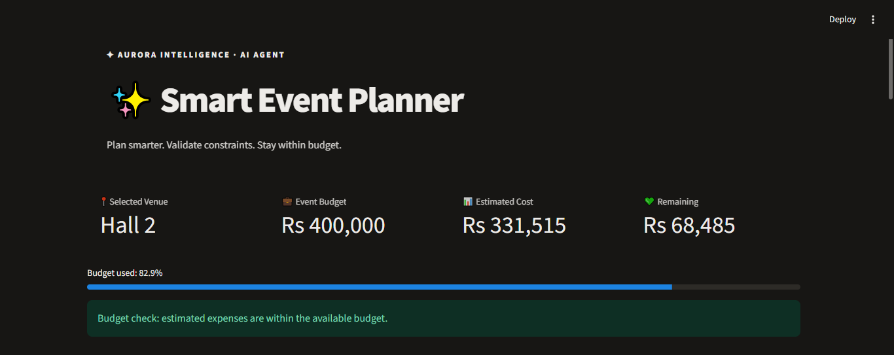
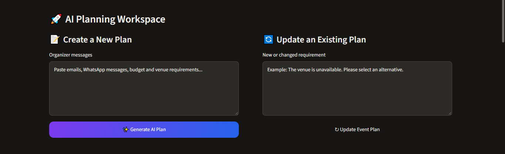
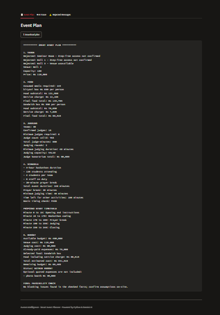

# Smart Event Planner — Aurora Intelligence

An AI-assisted event planning prototype for the Mind to Machine Hackathon. It extracts facts from organizer messages, checks venue constraints, estimates food/judging/budget costs, and produces a proposed event schedule. It includes a Streamlit dashboard and incremental updates.

## Setup (Windows / VS Code)

1. Install Python 3.11+ and open this folder in VS Code.
2. Create/activate a virtual environment:
   ```powershell
   py -m venv .venv
   .venv\Scripts\activate
   ```
3. Install dependencies:
   ```powershell
   python -m pip install -r requirements.txt
   ```
4. Create a local `.env` file containing `GEMINI_API_KEY=your_key`. **Do not commit `.env`**.
5. Run the initial workflow:
   ```powershell
   python run.py test_messages.txt
   ```
6. Open the UI:
   ```powershell
   python -m streamlit run aap_aurora_v2.py
   ```

The updated plan is saved to `plan.txt`; Gemini input, output, and reported token usage are saved to `trace.json`.

## Updates

After an initial run, process a *new* organizer message:

```powershell
python update.py new_message.txt
```

`update.py` processes new facts, replaces matching older facts (same key + entity), preserves distinct expenses, and regenerates `plan.txt`. It first tests the updated plan in a temporary folder; if planning fails, existing state/plan is kept. `update_trace.json` records model calls.

## Offline tests (no API key or paid calls)

```powershell
python -m unittest discover -s tests -v
python validator.py
```

The first command tests venue availability/accessibility, latest prices, service charge, budgeting, judging, invalid data, and fact merge rules using isolated fixtures. The second validates current `extracted_facts.json` when it exists.

## Safety, assumptions, limitations

- Venue accessibility must be confirmed explicitly; **a ramp reference alone may not establish step-free access throughout the venue**. Confirm facilities before booking.
- Meals are **assumed** for students + staff + judges unless a pack gives a different authoritative requirement.
- The schedule is a *proposed relative timetable*, not proof all activities, rooms, and breaks can be accommodated.
- The lowest quoted food option is chosen for the budget estimate; confirm suitability and attendance.
- Optional quotes are shown separately and not automatically included in committed expenses.
- Gemini may return invalid data, change entity spellings, be unavailable, or hit rate limits. Failed extraction is reported without overwriting previous files. Key/entity matching is not a complete semantic conflict resolver.
- Passing offline tests does **not** prove all real-world events correct. Human review remains necessary before financial commitments.

## Key files

| File | Purpose |
| --- | --- |
| `main.py` | Gemini extraction + initial model trace |
| `facts_engine.py` | Shared key normalization, validation, merging |
| `planner.py` | Venue, food, judging, schedule and budget calculations |
| `validator.py` | Fact validation with non-zero status on errors |
| `run.py` | Extraction → validation → planning |
| `update.py` | Incremental messages → verified updated plan |
| `aap_aurora_v2.py` | Theme-aware Streamlit dashboard |
| `tests/test_core.py` | Offline regression tests |

Default model can be configured with `GEMINI_MODEL` in the environment, provided it is supported by your Gemini account.
---

## 📸 Project Screenshots

### 1. Aurora Intelligence Dashboard

A modern AI-powered event planning dashboard showing the selected venue, total budget, estimated expenses, and remaining balance.



### 2. AI Planning Workspace

Users can generate a new event plan from organizer messages or update an existing plan when requirements change.



### 3. AI-Generated Event Plan

The system analyzes venue requirements, accessibility, food costs, judging capacity, scheduling, and budget constraints.



---

## 🧪 Testing

The project includes 14 automated regression tests covering:

- Venue selection and accessibility
- Venue availability constraints
- Updated food prices
- Budget calculations
- Judging capacity
- Invalid and missing data
- Conflict handling
- Duplicate expense prevention

**Test Results: 14/14 Passed**

Run the tests using:

```bash
python -m unittest discover -s tests -v